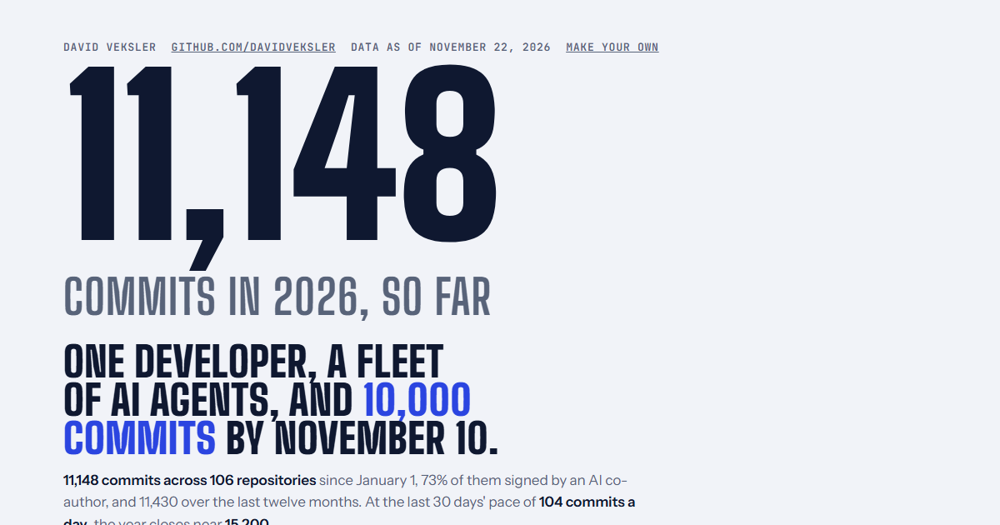

# ai-commit-report

Turn your GitHub history into a one-page, interactive report of how you ship with AI agents: commits per day and year, when they land on the clock, which models co-wrote them (from `Co-Authored-By` trailers), what your Claude Code and Codex sessions actually did, which repos and languages you touched, and your records.

**Demo:** [davidveksler.com/commits](https://davidveksler.com/commits/), built from 11,000+ commits across 168 repos in 2026.

[](https://davidveksler.com/commits/)

It reads every repo your account can see, public and private, on every branch. Raw commit data stays on your machine in `.cache/`; only aggregate counts reach the page, and private repos show as a bare commit count unless you give them a public label.

## Quick start

Requirements: Python 3.9+ (standard library only), git, the [GitHub CLI](https://cli.github.com/) logged in (`gh auth login`), and optionally Chrome, Edge or Chromium for the social-card image.

```bash
git clone https://github.com/DavidVeksler/ai-commit-report
cd ai-commit-report
# 1. Make it yours: edit data/report-config.json (see below) and empty data/display-names.json to {}
# 2. Collect, aggregate, build:
bash scripts/refresh.sh          # Windows: scripts\refresh.ps1
# 3. Open dist/index.html
```

The first run makes blobless clones of every repo (commit metadata only, no file contents), which takes a few minutes for a hundred repos. Later runs fetch only what changed; `--skip-fetch` reuses the clones as they are.

The repo ships with the demo's config and `data/stats.json`, so `python scripts/build.py` renders the demo page right away.

## Configure

Everything lives in `data/report-config.json`:

| Field | What it does |
| --- | --- |
| `profile.github_user`, `profile.name` | The account to scan and the name on the page. |
| `profile.identity_patterns` | Regexes over author name + email that mark a commit as yours (for old or work email addresses). Your GitHub noreply address and `git config user.email` are matched automatically; extra addresses can go in the `COMMIT_REPORT_EMAILS` environment variable (comma-separated) so they never land in the config. |
| `profile.bot_authors` | Author names of your CI or cron bots. Counted separately from your own commits. |
| `profile.timezone_label` | Shown in the footer. Hours use the timezone each commit recorded. |
| `profile.links` | Buttons at the end of the page (`primary: true` for the filled one). |
| `profile.playbook` | Optional HTML section before the links. The demo's is `data/playbook.html`; delete the field to drop it. |
| `site` | Head tags for the standalone page: title, description, canonical URL, social image, JSON-LD ids, and `publish_dir` for `scripts/sync_site.py`. Empty values are left out. |
| `year`, `goal` | The year to report and the headline goal. |
| `workday` | Your working hours; the clock chart shades everything outside them. |
| `exclude_owners` | Owners to skip entirely. |
| `mask_owners`, `mask_repos` | Owners or `owner/repo` names that always render as a bare number (an employer org, a private side project). Use `python scripts/mask.py name` to get a `sha256:` entry that keeps the name itself out of a public config. |
| `top_repos`, `label_min_radius`, `number_min_radius` | Repo bubble chart size and labeling. |
| `shell_buckets`, `tool_labels`, `tool_chart_rows` | How agent tool calls are grouped in the "one prompt, N actions" chart. |
| `languages`, `language_min_commits` | File extension to language mapping. |

`data/display-names.json` maps `owner/repo` to a public label for the repo chart. Public repos fall back to their repo name; private repos not listed there show only their commit count.

## What counts

- Commits on any branch of any repo you own, collaborate on or reach through an organization, deduplicated by SHA.
- Yours: authored under your identities (above). Commits authored by Claude Code worktree agents (`noreply@anthropic.com`) and by your bots are reported separately. Dependabot and upstream authors in forks are excluded.
- AI attribution: a `Co-Authored-By` trailer naming Claude, Codex/OpenAI or Copilot. Everything else is "No trailer", which includes hand-written commits and tools that do not sign their work. `scripts/chatgpt_estimate.py` gives a bounded estimate for ChatGPT/Codex commits without a trailer.
- Agent activity: `scripts/sessions.py` counts prompts, sessions, sub-agents and tool calls in the local transcripts under `~/.claude/projects` and `~/.codex/sessions`. Counts only; no transcript text is read into the output. If you have no transcripts, that section is skipped.
- Pace and the goal date use the trailing 30 days.

GitHub's own contribution graph counts differently (default branch only, plus pull requests and issues). `python scripts/reconcile.py` prints both side by side.

## Scripts

| Script | Does |
| --- | --- |
| `scripts/refresh.sh` / `refresh.ps1` | Runs the whole pipeline below. |
| `scripts/collect.py` | Lists your repos with `gh`, mirrors them into `.cache/repos/`, writes `.cache/commits.jsonl`. |
| `scripts/sessions.py` | Summarizes local Claude Code and Codex transcripts into `.cache/sessions.json`. |
| `scripts/aggregate.py [--asof YYYY-MM-DD]` | Writes `data/stats.json`, the only data the page uses. |
| `scripts/build.py` | Writes `dist/index.html` (standalone page) and `dist/artifact.html` (body fragment). |
| `scripts/og.py` | Renders `dist/og.png`, the 1200x630 social card, with a headless browser (`BROWSER=/path` to choose one). |
| `scripts/sync_site.py [dir]` | Copies `index.html` and `og.png` into your website checkout. |

The page is a single HTML file with D3 from a CDN; host it anywhere static.

## Privacy

`.cache/` holds raw commit messages and private repo names and is gitignored. Before publishing, read `data/stats.json`: it holds counts, dates, public labels and the most common words in commit subjects of unmasked repos (the page itself drops the word lists).

## License

MIT. See [LICENSE](LICENSE).
